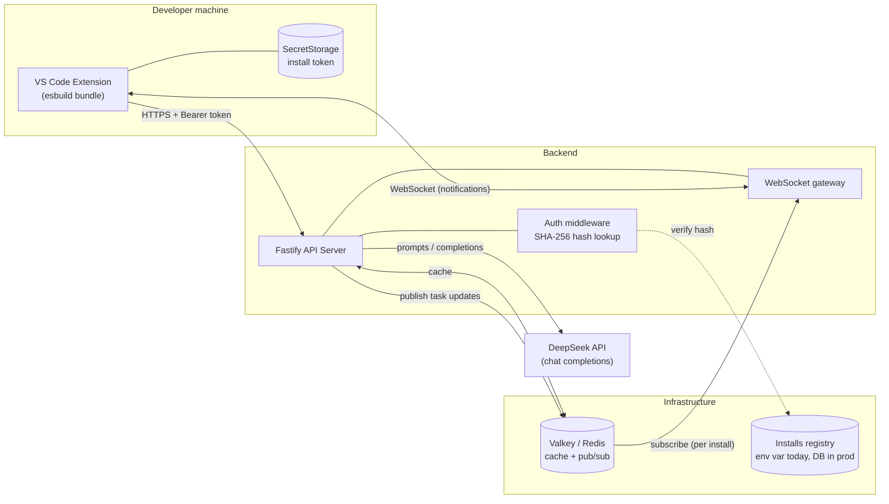
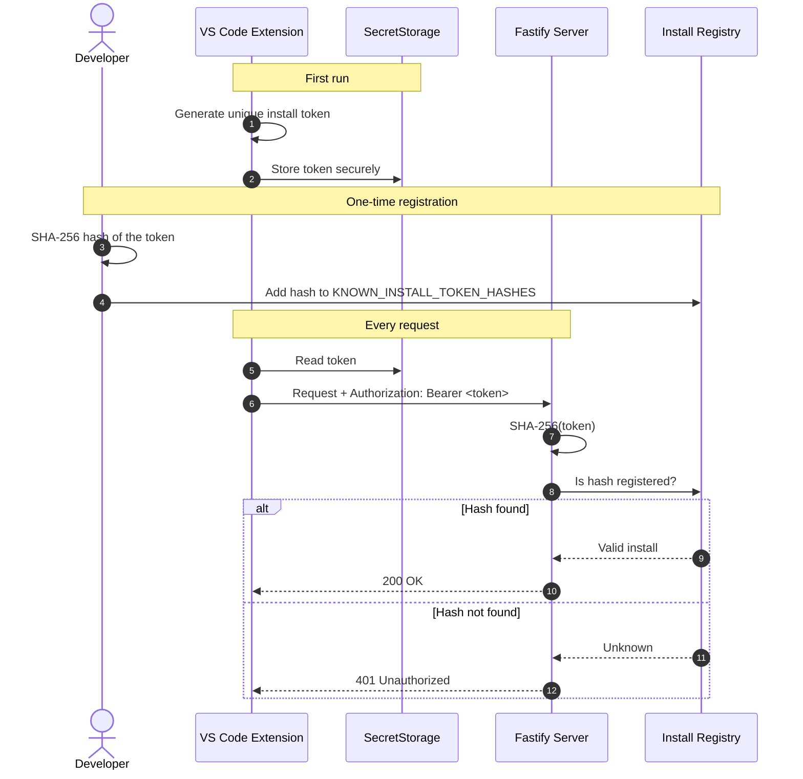
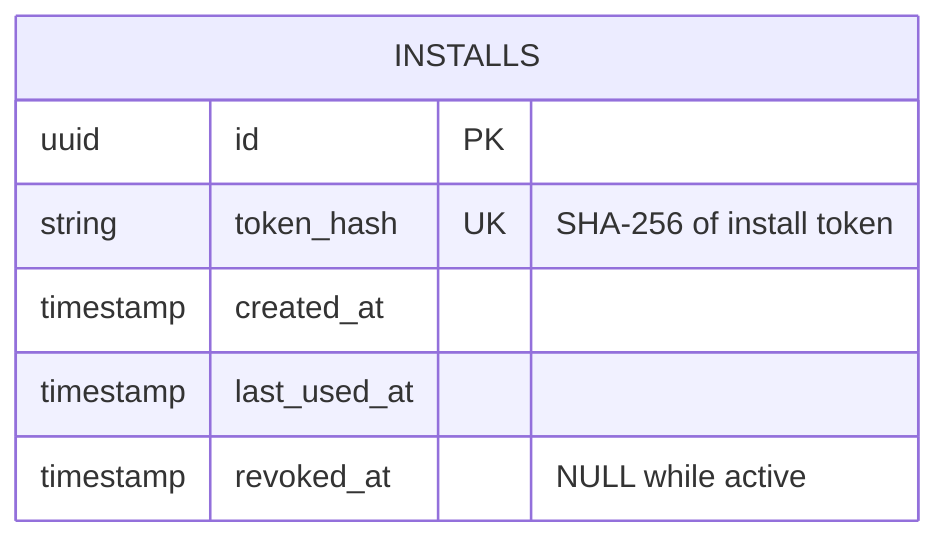
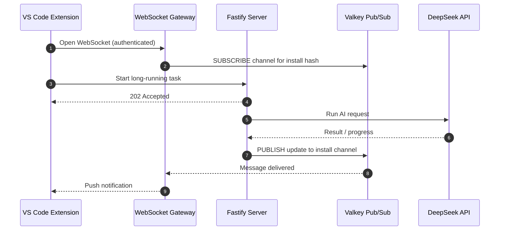
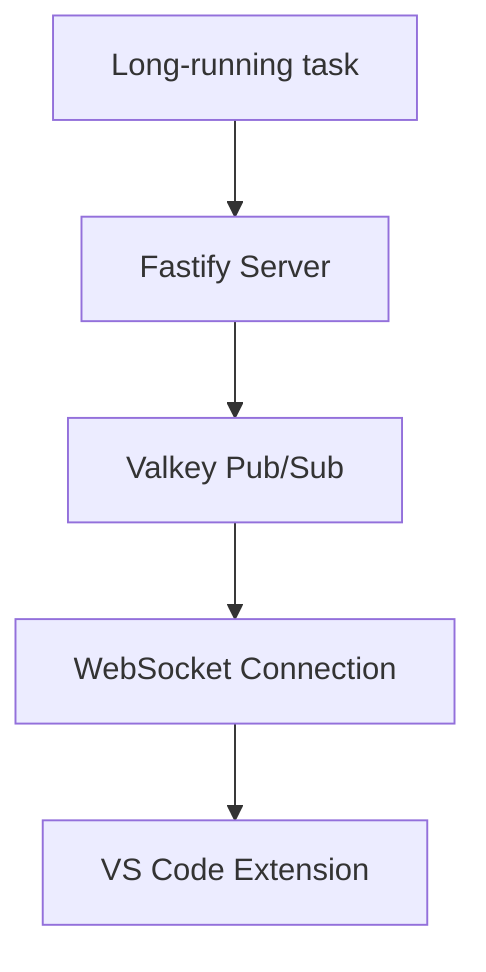
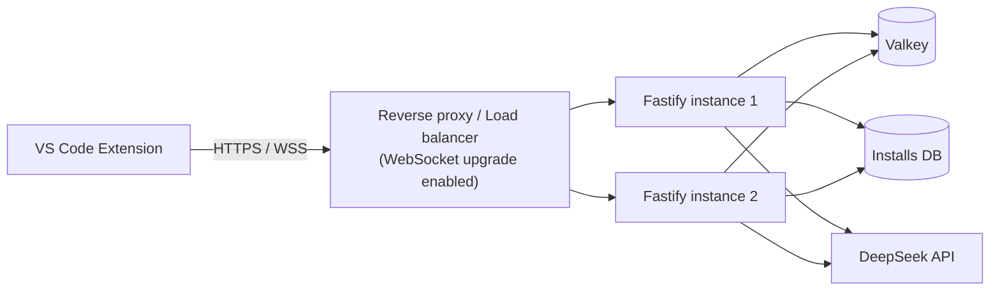

# Susie

> A DeepSeek-powered AI coding assistant for VS Code, backed by a secure Fastify server.


Susie is a VS Code extension backed by a Fastify server. Its AI coding features use the **DeepSeek chat completions API**. The extension authenticates with a **per-install token** (never stored in plaintext on the server) and receives **real-time notifications** over WebSockets for long-running tasks.

## Table of Contents

- [Architecture](#architecture)
- [Project Structure](#project-structure)
- [Quick Start](#quick-start)
- [Server Setup](#server-setup)
- [Extension Setup](#extension-setup)
- [Configuration](#configuration)
- [Authentication Flow](#authentication-flow)
- [Real-Time Notifications](#real-time-notifications)
- [Production Checklist](#production-checklist)
- [Deployment](#deployment)
- [Troubleshooting](#troubleshooting)
- [License](#license)

---

## Architecture

High-level view of the system and how its parts connect:



### Components

| Component | Responsibility |
|-----------|----------------|
| **VS Code Extension** | UI, commands, token generation, request/notification client |
| **Fastify Server** | REST API, authentication, DeepSeek API calls, WebSocket gateway |
| **Valkey / Redis** | Response caching, pub/sub channel for task updates |
| **Install registry** | Maps hashed tokens to valid installs (`KNOWN_INSTALL_TOKEN_HASHES` for now) |
| **DeepSeek API** | LLM chat completions that power the AI coding features |

---

## Project Structure

```
susie/
├── server/       # Fastify API server
└── extension/    # VS Code extension
```

---

## Quick Start

```bash
# 1. Start Valkey (any Redis-compatible instance works)
docker run -d --name valkey -p 6379:6379 valkey/valkey

# 2. Start the server (Node.js 18+)
cd server
npm install
cp .env.example .env      # then fill in your values
npm run dev

# 3. Build the extension
cd ../extension
npm install
npm run build

# 4. Press F5 in VS Code to launch the Extension Development Host
```

---

## Server Setup

### Requirements

- **Node.js 18 or newer** (the server uses the built-in `fetch` API)
- A valid **DeepSeek API key**
- A running **Valkey/Redis** instance, used for:
  - caching
  - publish/subscribe notifications
  - long-running task updates

Default Valkey connection: `redis://localhost:6379`

### Installation

```bash
cd server
npm install
cp .env.example .env
```

### Environment Variables

| Variable | Description | Example |
|----------|-------------|---------|
| `DEEPSEEK_API_KEY` | Your DeepSeek API key | `your_deepseek_api_key` |
| `KNOWN_INSTALL_TOKEN_HASHES` | Comma-separated SHA-256 hashes of allowed install tokens | `token_hash_1,token_hash_2` |
| `VALKEY_URL` | Valkey/Redis connection string | `redis://localhost:6379` |

### Run

```bash
npm run dev     # development server
npm test        # run tests
```

The server is available at `http://localhost:3000`.

---

## Extension Setup

### Installation

```bash
cd extension
npm install
npm run build
```

This bundles the extension with esbuild into `dist/extension.js`.

### Development

1. Open the project in VS Code.
2. Press **F5**.
3. A new **Extension Development Host** window opens with the extension loaded.

### Package as VSIX

```bash
vsce package
```

This generates `susie-x.x.x.vsix`. Install it manually via:

**Extensions → ⋯ → Install from VSIX...**

---

## Configuration

Set the backend URL in your VS Code `settings.json`:

```json
{
  "mistralAssistant.serverUrl": "http://localhost:3000"
}
```

> **Note:** the setting name `mistralAssistant.serverUrl` is retained for compatibility with existing installations.

For production, point this to your hosted server URL (use `https://`).

---

## Authentication Flow

Susie uses a per-install token. The server never stores raw tokens, only their SHA-256 hashes.



### First Run

1. The extension activates.
2. A unique install token is generated.
3. The token is stored in VS Code `SecretStorage`.
4. Every request to the server includes the token as a `Bearer` header.

### Registering an Install

1. Hash the extension's token with SHA-256, for example:

   ```bash
   echo -n "YOUR_INSTALL_TOKEN" | sha256sum
   ```

2. Add the hash to your `.env`:

   ```env
   KNOWN_INSTALL_TOKEN_HASHES=abc123hash,def456hash
   ```

3. Restart the server.

### Token Rotation

Users can regenerate their token at any time:

**Command Palette → `Mistral Assistant: Rotate Install Token`**

After rotating, register the new token's hash with the server and remove the old one.

### Recommended Production Schema



---

## Real-Time Notifications

The server pushes updates to the extension over WebSockets, using Valkey pub/sub as the bridge between long-running tasks and open connections. Notifications are isolated per installation using hashed install tokens, so one install never sees another's updates.



Simplified flow:



---

## Production Checklist

Before deploying, work through these items:

- [ ] **Database-backed authentication**
- [ ] **Rate limiting**
- [ ] **WebSocket proxy support**
- [ ] **HTTPS everywhere**
- [ ] **Secrets management** (don't commit `.env`)

### Database-backed Authentication

Replace `KNOWN_INSTALL_TOKEN_HASHES` with a persistent lookup. The database should support:

- token creation
- token revocation
- last activity tracking
- audit history

### Rate Limiting

Add request protection with [`@fastify/rate-limit`](https://github.com/fastify/fastify-rate-limit):

- limit by install token hash
- prevent abuse of AI endpoints
- protect expensive operations

### WebSocket Proxy Support

The notification system requires WebSocket upgrade support. Make sure your reverse proxy or load balancer forwards:

```
Connection: Upgrade
Upgrade: websocket
```

Some hosting providers require explicit WebSocket configuration.

### Recommended Production Topology



Because notifications go through Valkey pub/sub, any server instance can publish an update and the instance holding the client's WebSocket will deliver it, so you can scale horizontally.

---

## Deployment

The server runs on any platform that supports Node.js 18+.

Required environment variables:

```env
DEEPSEEK_API_KEY=
KNOWN_INSTALL_TOKEN_HASHES=
VALKEY_URL=
```

After deployment:

1. Update `mistralAssistant.serverUrl` in VS Code.
2. Register production install tokens.
3. Verify WebSocket connectivity.

---

## Troubleshooting

| Symptom | Likely cause | Fix |
|---------|--------------|-----|
| `401 Unauthorized` | Token hash not registered | Hash the token and add it to `KNOWN_INSTALL_TOKEN_HASHES`, then restart |
| `fetch is not defined` | Node.js older than 18 | Upgrade to Node.js 18 or newer |
| AI requests fail | Missing or invalid DeepSeek key | Check `DEEPSEEK_API_KEY` in `.env` |
| No real-time notifications | Proxy blocks WebSocket upgrade | Forward `Connection: Upgrade` / `Upgrade: websocket` headers |
| Server fails on startup | Valkey/Redis not reachable | Check `VALKEY_URL` and that the instance is running |
| Extension can't reach server | Wrong `serverUrl` | Check `mistralAssistant.serverUrl` in VS Code settings |
| Auth broke after token rotation | New hash not registered | Register the new hash, remove the old one |

---

## License

Add your project license information here (for example, MIT) and include a `LICENSE` file in the repository root.
